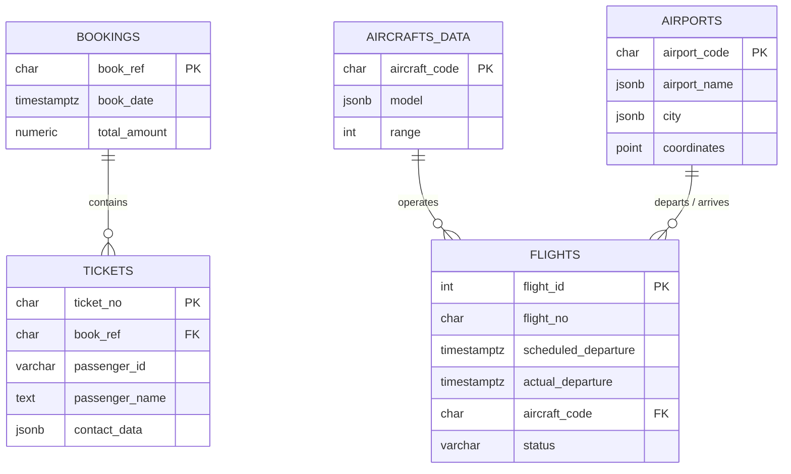

<div align="center">

# ✈️ Airport Relational Database & SQL Data Analysis


Analytical SQL query suite executed over a relational **Aviation & Flight Bookings Database** in **PostgreSQL**.  
Demonstrates relational data exploration, schema introspection (`information_schema`), pattern matching (`ILIKE`), multi-table `JOIN` aggregations, `GROUP BY` / `HAVING` filtering, and timestamp `INTERVAL` delay analytics.

</div>

---

## 📑 Table of Contents

- [Overview](#-overview)
- [Database Schema](#-database-schema)
- [Analytical Queries Summary](#-analytical-queries-summary)
- [Detailed Query Breakdown](#-detailed-query-breakdown)
- [How to Run](#-how-to-run)
- [Author](#-author)

---

## 🔍 Overview

This repository contains [`introBBDD.sql`](introBBDD.sql), a structured set of **9 analytical SQL queries** designed to extract operational and business insights from an airport and airline booking database:

- **Flight Operations:** Tracking on-time flights, aircraft model utilization, and departure delays exceeding 1 hour.
- **Commercial & Revenue Metrics:** Identifying high-value bookings (`total_amount >= 1,000,000`) and multi-passenger reservations.
- **Passenger & Infrastructure Analysis:** Filtering passenger ticket records and identifying multi-airport metropolitan hubs.

---

## 🗂 Database Schema



---

## 📊 Analytical Queries Summary

| # | Analytical Objective | Core SQL Features Used | Target Tables |
|:-:|---|---|---|
| **1** | Retrieve all flights currently marked as `On Time` | `SELECT`, `WHERE` | `flights` |
| **2** | Extract high-value bookings (`≥ 1,000,000` monetary units) | Numeric comparison (`>=`) | `bookings` |
| **3** | Inspect table column metadata dynamically | `information_schema.columns` | `information_schema` |
| **4** | Identify flights operated by a **Boeing 737** (`aircraft_code = '733'`) | Filtering by foreign key code | `flights` |
| **5** | Retrieve ticket details for passengers named **Irina** | Case-insensitive prefix match (`ILIKE 'irina %'`) | `tickets` |
| **6** | Find cities served by **more than one airport** | `COUNT(*)`, `GROUP BY`, `HAVING` | `airports` |
| **7** | Calculate total number of flights per **aircraft model** | `INNER JOIN`, `COUNT()`, `GROUP BY` | `flights`, `aircrafts_data` |
| **8** | List booking references with **multiple passengers/tickets** | `INNER JOIN`, `COUNT()`, `GROUP BY`, `HAVING` | `bookings`, `tickets` |
| **9** | Detect flights with a **departure delay greater than 1 hour** | Timestamp arithmetic & `INTERVAL '1 hour'` | `flights` |

---

## 🧩 Detailed Query Breakdown

### 1. On-Time Flights
Retrieves the flight identifier and operational status for all flights currently on schedule:
```sql
SELECT f.flight_id, f.status 
FROM flights f 
WHERE f.status = 'On Time';
```

### 2. High-Value Bookings
Extracts all columns for bookings whose `total_amount` reaches or exceeds `1,000,000`:
```sql
SELECT *
FROM bookings b
WHERE b.total_amount >= 1000000;
```

### 3. Schema Metadata Inspection
Queries PostgreSQL's `information_schema` catalog to inspect the structure of the `bookings` table:
```sql
SELECT c.column_name 
FROM information_schema."columns" c 
WHERE c.table_name = 'bookings';
```

### 4. Boeing 737 Flight Operations
Finds all flight IDs operated by aircraft code `'733'` (Boeing 737):
```sql
SELECT f.flight_id 
FROM flights f 
WHERE f.aircraft_code = '733';
```

### 5. Passenger Ticket Search (`ILIKE`)
Performs a case-insensitive search for all tickets purchased by passengers with the first name *Irina*:
```sql
SELECT *
FROM tickets t 
WHERE t.passenger_name ILIKE 'irina %';
```

### 6. Multi-Airport Cities
Groups airports by city and filters for metropolitan areas with more than one airport:
```sql
SELECT a.city, COUNT(*) AS total_aeropuertos
FROM airports a 
GROUP BY a.city 
HAVING COUNT(*) > 1;
```

### 7. Flight Volume by Aircraft Model
Joins `flights` and `aircrafts_data` to count how many flights each aircraft model has operated:
```sql
SELECT ad.model, COUNT(f.flight_id) AS total_vuelos
FROM flights f 
JOIN aircrafts_data ad ON f.aircraft_code = ad.aircraft_code
GROUP BY ad.model;
```

### 8. Multi-Passenger Bookings
Joins `bookings` and `tickets` to identify reservations containing more than one ticket:
```sql
SELECT b.book_ref, COUNT(t.ticket_no) AS numero_total_pasajeros
FROM bookings b 
JOIN tickets t ON b.book_ref = t.book_ref 
GROUP BY b.book_ref 
HAVING COUNT(t.ticket_no) > 1;
```

### 9. Departure Delays Exceeding 1 Hour
Computes the real departure delay (`actual_departure - scheduled_departure`) and filters for delays strictly greater than `INTERVAL '1 hour'`:
```sql
SELECT f.flight_id, (f.actual_departure - f.scheduled_departure) AS retraso
FROM flights f 
WHERE f.actual_departure - f.scheduled_departure > INTERVAL '1 hour';
```

---

## 🚀 How to Run

1. **Clone the repository:**
   ```bash
   git clone https://github.com/pablotome8/proyecto4-SQL-airport-pabloTomeManzano.git
   cd proyecto4-SQL-airport-pabloTomeManzano
   ```
2. **Execute the SQL script against your PostgreSQL database** (using `psql`, DBeaver, or pgAdmin):
   ```bash
   psql -U postgres -d demo -f introBBDD.sql
   ```

---

## 👤 Author

**Pablo Tomé Manzano**  
Project 4 · Relational Databases & SQL Data Analysis.

- GitHub: [@pablotome8](https://github.com/pablotome8)
